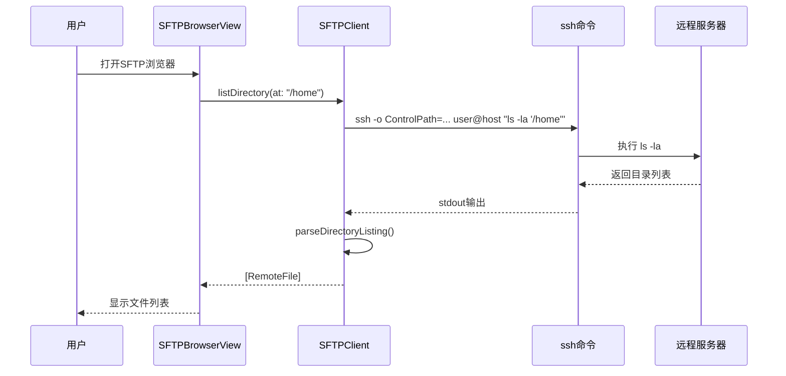
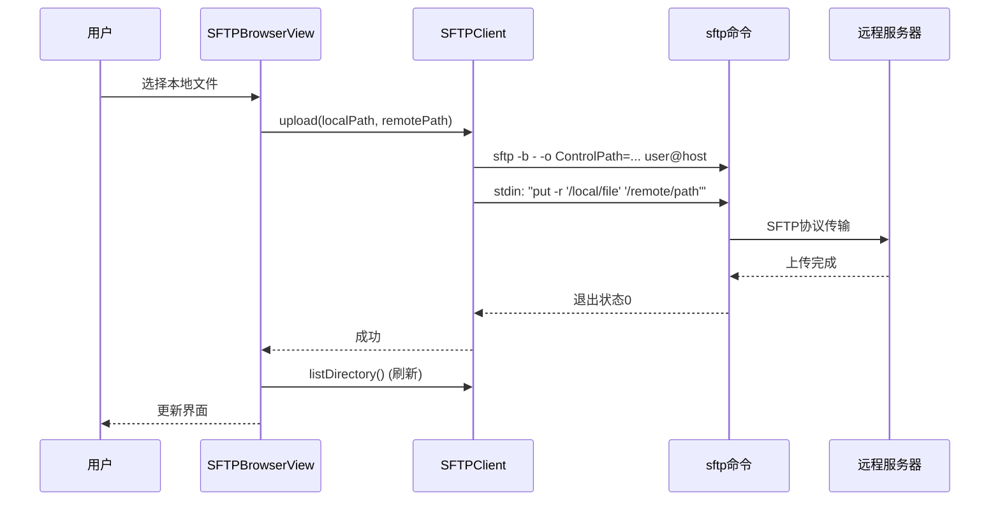
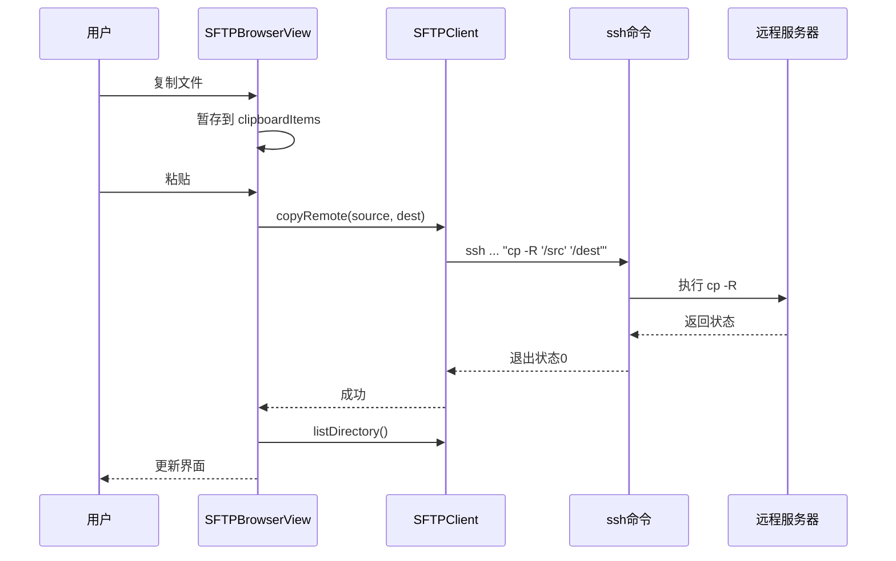
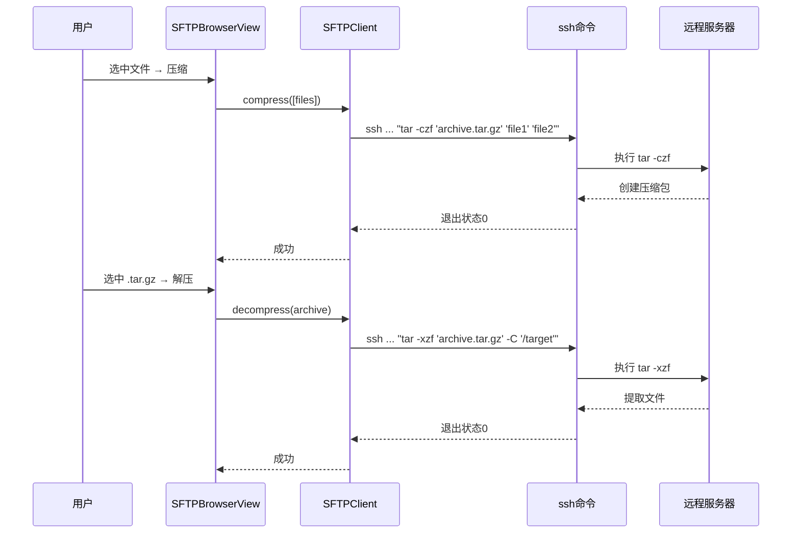

# SFTP 功能架构

本文档描述 MTunl SFTP 文件浏览器的实现架构。

## 组件概览

```mermaid
graph TB
    UI[SFTPBrowserView<br/>SwiftUI 界面]
    Model[TunnelModel<br/>窗口管理]
    Client[SFTPClient<br/>核心逻辑]
    SSH[/usr/bin/ssh]
    SFTP[/usr/bin/sftp]
    Remote[远程服务器]
    
    UI -->|用户操作| Model
    Model -->|创建窗口| UI
    UI -->|调用| Client
    Client -->|ls/stat/tar| SSH
    Client -->|get/put| SFTP
    SSH -->|ControlMaster| Remote
    SFTP -->|ControlMaster| Remote
    
    style UI fill:#38BDF8
    style Client fill:#F97316
    style Remote fill:#4FD1C5
```

## 操作流程

### 目录浏览



### 文件上传



### 远程复制



### 压缩与解压



## 连接复用

MTunl SFTP 利用 SSH ControlMaster 实现连接复用：

1. **隧道运行时**：
   - `SFTPClient` 使用 `-o ControlPath=/tmp/mtunl-<uid>/ssh-<id>.sock`
   - `-o ControlMaster=no`：不创建新的 master，只使用已有的
   - 所有操作共享隧道的 SSH 连接，无需重新认证

2. **隧道未运行时**：
   - 尝试建立独立连接（需要密钥或 SSH agent）
   - 不支持交互式密码输入

## 安全机制

### 参数转义

```swift
// Shell 命令参数（ls、stat、tar、cp、mv）
func escapeShellArg(_ arg: String) -> String {
    "'\(arg.replacingOccurrences(of: "'", with: "'\\''"))'"
}

// SFTP batch 命令参数（get、put、rm、rename）
func escapeSFTPArg(_ arg: String) -> String {
    var escaped = "\""
    for character in arg.unicodeScalars {
        switch character {
        case "\"": escaped += "\\\""
        case "\\": escaped += "\\\\"
        case "\n": escaped += "\\n"
        case "\r": escaped += "\\r"
        case "\t": escaped += "\\t"
        default: escaped.append(Character(character))
        }
    }
    escaped += "\""
    return escaped
}
```

### Pipe 缓冲区管理

```swift
// ❌ 错误：先 wait 再读，大量输出会死锁
process.waitUntilExit()
let output = outputPipe.fileHandleForReading.readDataToEndOfFile()

// ✅ 正确：先读到 EOF 再 wait
let output = outputPipe.fileHandleForReading.readDataToEndOfFile()
process.waitUntilExit()
```

### 错误传播

所有 `SFTPClient` 方法都使用 `async throws`，错误会传播到 UI 层并显示给用户。

## 性能优化

1. **批量操作顺序执行**：避免并发冲突和资源竞争
2. **目录递归下载/上传**：使用 `get -r`/`put -r` 而不是逐个文件传输
3. **远程操作避免传输**：复制、移动、压缩都在远程执行，不经过本地
4. **连接复用**：所有操作共享同一个 SSH 连接

## 局限性

1. **无进度显示**：当前 UI 不显示传输进度，大文件操作可能看起来"卡住"
2. **无断点续传**：传输中断需要重新开始
3. **无拖拽支持**：只能通过按钮上传
4. **无预览功能**：不支持文本或图片预览
5. **依赖远程工具**：`ls`、`stat`、`tar` 必须在远程 PATH 中可用
6. **格式依赖**：`stat` 输出格式在不同系统（Linux vs macOS）上不同，通过 `||` 回退处理

## 未来改进方向

- [ ] 传输进度条和速度显示
- [ ] 拖拽上传支持
- [ ] 文本文件预览和编辑
- [ ] 搜索功能
- [ ] 书签（快速访问常用目录）
- [ ] 并行传输多个文件
- [ ] 支持其他压缩格式（zip、7z）
- [ ] 符号链接处理
- [ ] 文件权限编辑器（chmod 图形界面）
